# V-IMMUNE architecture

## Package → report section map

| report § | package | what it implements |
|---|---|---|
| 2.1 System, data, simulator, reference detector | `vimmune/config.py`, `io/`, `sim/`, `detect/`, `dsp.py` | pydantic configs, BDW schema (Parquet, labeling JSON), int16/f32/SigMF IQ + burst store; GFSK/OFDM/noise waveforms, fictional families P1–P8, channel, streaming scenes, fast BDW mode; STFT + noise floor + 2-D CA-CFAR detector behind the `Detector` protocol |
| 2.2 Tokenization | `tokenize/` | 6-field quantizers with [PAD]/[MASK]/[BOS], burst preprocessing, 1-D CNN VQ-VAE (EMA codebook, dead-code restart) |
| 2.3 Source association | `associate/` | graph grouping (z, BW, PW), SDIF deinterleaving (Milojević & Popović), Hungarian tracking, purity / completeness / ID switches |
| 2.4 SpectrumLM | `lm/` | decoder-only Transformer, Fourier time encoding, six next-burst heads, pretraining, classifier head, centroids, per-burst / per-window surprise |
| 2.5 Open-set decision | `openset/` | SNR-binned calibration (LOWESS-style), distance score, fusion α, conformal p-values, CUSUM with κ/h chosen by simulation |
| 2.6 Grammar induction | `grammar/` | channel set, frame period (SDIF + folding), hop type (entropy rate), adaptive avoidance, link pairing, similarity → Protocol ID Card |
| 2.7 Vaccine | `vaccine/` | sequence generator, conditional DDPM + LoRA + DDIM, parametric fallback, channel augmentation, quality filter, LoRA adapter, validation gate |
| 2.8 Edge, release, federation | `edge/` | distillation, ONNX + INT8 PTQ, async edge pipeline, Ed25519-signed `.vpkg`, hot-loading nodes, 3-node FedAvg |
| 2.9 Evaluation | `eval/` | leave-classes-out folds, blob-CNN baselines (MSP, energy, OpenMax, centroid), ablations, `table3.md`, `report.html` |
| 2.10 Demo | `demo/`, `cli.py`, `pipeline.py` | cached stage orchestrator, Streamlit app, static HTML report; `pipeline.py` holds the stages shared by CLI / demo / eval |

## Dataflow

```mermaid
flowchart LR
  subgraph S21["§2.1 sensing"]
    SIM["sim/ scenes<br/>(full IQ, SigMF)"] --> DET["detect/ ReferenceDetector<br/>STFT + CA-CFAR"]
    FAST["sim/fastbdw<br/>corpus (BDW + snippets)"]
    REC["recorded SigMF"] --> DET
  end
  DET -->|BDW + burst IQ| TOK
  FAST --> TOK
  subgraph S22["§2.2"]
    TOK["tokenize/ quantizers<br/>+ VQ-VAE (z, code)"]
  end
  TOK -->|z| ASSOC["§2.3 associate/<br/>graph → SDIF → Hungarian"]
  TOK -->|tokens| LM
  ASSOC -->|tracks ≥ 32 bursts| LM["§2.4 lm/ SpectrumLM"]
  LM -->|surprise S, h, logits| OS["§2.5 openset/<br/>z_S, z_d, U, conformal p, CUSUM"]
  OS -->|known| OUT["label"]
  OS -->|unknown track| GR["§2.6 grammar/<br/>Protocol ID Card"]
  GR -->|approved card + K real bursts| VAC["§2.7 vaccine/<br/>sequences + DDPM/param waveforms<br/>→ LoRA adapter → gate"]
  VAC -->|gate passed + human approval| REL["§2.8 edge/release<br/>signed .vpkg"]
  REL --> NODES["edge nodes<br/>hot-load, score"]
  NODES -->|BDW + int8 z, calib stats| FED["FedAvg aggregator"]
  VAC --> DIST["§2.8 distill → ONNX INT8"]
  DIST --> NODES
  OS --> EVAL["§2.9 eval/ LOCO, baselines, ablations"]
```

## Stage contract

Every stage reads inputs from a directory and writes outputs (plus a `metrics.json` / report JSON) to its own
directory under `runs/`. Nothing passes between stages in memory. Every number in a report can therefore be traced to a file, and the demo can
cache stages by content hash (`runs/demo/status.json`).
