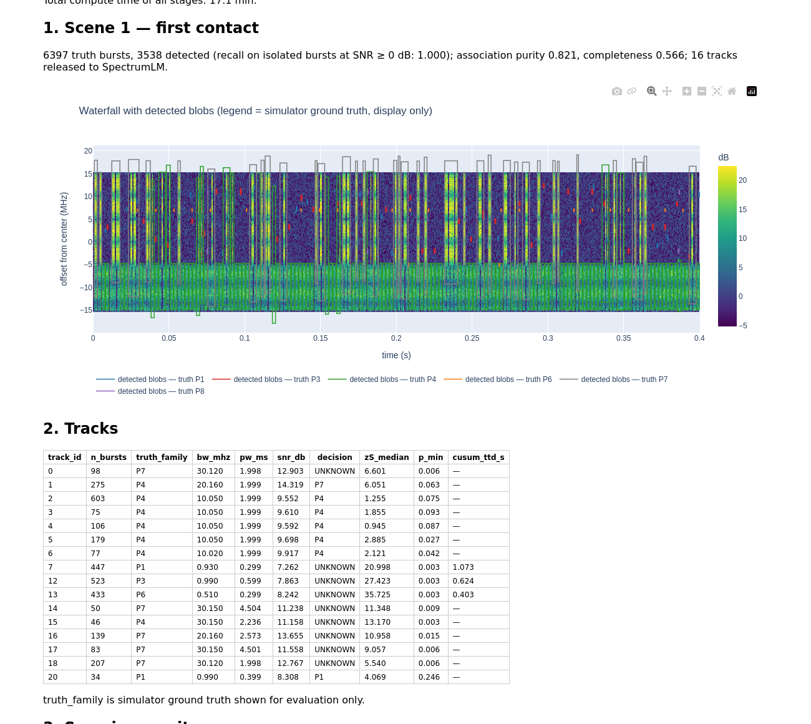
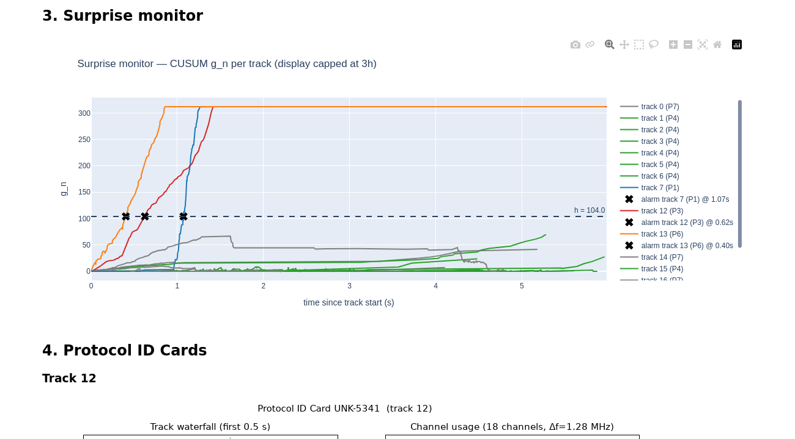
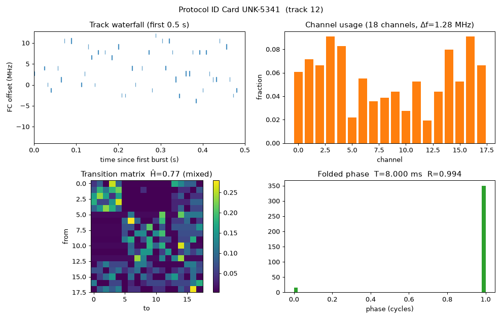

# V-IMMUNE

Receive-only RF burst analysis that **detects previously unseen (fictional) UAV-style protocols**, describes
them with a Protocol ID Card, learns them from a few real bursts ("vaccine") and ships a signed adapter to
edge nodes that hot-load it.

> **Scope.** Passive analysis only. No transmit, jamming, spoofing or payload decoding code exists in this repo,
> and no real commercial protocol is modelled. All signals come from the built-in simulator (fictional families
> P1–P8) or from user-supplied recordings.

## What the demo shows (numbers from `runs/demo`, demo profile, 8-core CPU)

`make check && make demo` on a clean checkout: 44 tests pass; the demo finishes in **15.7 min** of stage compute
(`runs/demo/status.json`). The numbers below come from that run.

| step | result (file) |
|---|---|
| Training corpus | 111 k measured bursts, known families P1, P2, P4, P5, P7, P8; P3 and P6 hidden (`corpus/meta.json`) |
| SpectrumLM (demo size, 1.2 M params) | known-class window accuracy 1.00 on the session-disjoint test split (`lm/metrics.json`) |
| Calibration | false-unknown rate on held-out known windows 5.4 % at ε = 5 %; CUSUM κ = 2, h = 104 (MTBFA ≥ 1 h per known family, block-bootstrap simulation) (`calibrate/metrics.json`) |
| Scene 1 (6 s, 30.72 MHz full IQ) | detector recall 1.00 on isolated bursts at SNR ≥ 0 dB; 16 tracks released (`scene1/detect_info.json`) |
| First contact | the unknown **P3** track (purity 0.998) is flagged: conformal p = 0.003, CUSUM alarm **0.62 s** after its first burst; the hidden P6 track alarms at 0.40 s (`scene1/tracks_base.parquet`) |
| Protocol ID Card (P3) | 18 channels (truth 20; Jaccard 0.90), frame period 8.000 ms (relative error 8e-7), hopping "mixed", **adaptive avoidance detected** (`cards/track12/card.json`) |
| Vaccine (K = 30 real bursts) | 200 synthetic sequences; waveforms from the **parametric fallback** (the tiny demo DDPM produced 0 samples passing the quality filter, as reported); adapter 40 KB; flag → adapter 110 s (`vaccine/vaccine_report.json`) |
| Gate (real data only) | held-out real recall 1.00, known accuracy drop 0.0 pp, background false-alarm increase +0.76 pp (≤ 1 pp), human approval via `--approve` → **passed** (`vaccine/gate_report.json`) |
| Release + fleet | Ed25519-signed `vimmune-1.1.0.vpkg`; 3 node processes hot-load 1.0.0 → 1.1.0 mid-stream without restart; upstream 96 B/burst (≈14–50 kB/s per node vs 122.9 MB/s raw IQ at 30.72 MHz, 983 MB/s at 245.76 MHz) (`fleet/fleet_report.json`) |
| Scene 2 (immunity) | the P3 track: before **UNKNOWN** (CUSUM alarm 0.51 s) → after classified **P3** 0.28 s after its first burst (`scene2/before_after.parquet`) |
| Edge | student (2 layers) accuracy 0.997 vs teacher 1.000; open-set AUROC (pseudo-unknowns) 0.900 vs 0.965; INT8 ONNX 0.898, 1.1 MB (fp32 2.2 MB); async detector→tokenizer→association→INT8-student pipeline on 2 s of scene-1 IQ: 27 bursts/s (0.05× real time), decision latency mean 5.4 s / p99 16 s, peak RSS 1.4 GB (`edge/edge_report.json`) |
| `make eval` (2 LOCO folds, `runs/eval/table3.md`) | V-IMMUNE AUROC 0.890 ± 0.110, TPR@5 % 0.75, time-to-detect 0.34 s; blob-CNN baselines AUROC 0.42–0.46 |
| Table 3 (demo fold, hidden P3+P6) | V-IMMUNE AUROC 1.000, TPR@5 % 1.000, time-to-detect 0.37 s (CUSUM 0.43 s); blob-CNN baselines: MSP 0.10, energy 0.19, OpenMax 0.45, nearest centroid 0.50 (`table3.md`) |

Scene 1 waterfall with detected blobs and the track table (from `runs/demo/demo_report.html`):



CUSUM surprise monitor (P3 red, P6 orange, alarms marked):



Protocol ID Card inferred for the P3 track:




## Quickstart

```bash
# CPU-only works; Python 3.11 venv recommended
python3.11 -m venv .venv && source .venv/bin/activate
pip install -r requirements.txt && pip install -e .
make check          # ruff + mypy + pytest
make demo           # whole story, demo profile (<= ~20 min on an 8-core CPU)
make ui             # Streamlit app over runs/demo
open runs/demo/demo_report.html   # static, self-contained version of the demo
make eval           # leave-classes-out folds (demo profile, 2 folds) -> runs/eval/{table3.md,report.html}
```

`make demo-clean` wipes the stage cache (`runs/demo`). Re-running `make demo` or the UI never retrains a stage whose inputs, config and code are unchanged.

## Architecture

See [ARCHITECTURE.md](ARCHITECTURE.md) for the Mermaid dataflow diagram.

```
IQ (SigMF / sim) → detect/ (STFT + CA-CFAR) → BDW + burst IQ → tokenize/ (6 fields, VQ-VAE) → associate/ (graph → SDIF → Hungarian)
   → lm/ SpectrumLM → openset/ (z_S, z_d, conformal p, CUSUM) ─┬─ known → label
                                                               └─ unknown → grammar/ card → vaccine/ (synthesis → LoRA adapter → gate)
                                                                    → edge/ (signed .vpkg → hot-loading nodes, FedAvg; distilled INT8 student)
```

## Report section → code

| § | topic | code |
|---|---|---|
| 2.1 | data model, IQ I/O, simulator, reference detector | `src/vimmune/{config.py,io/,sim/,detect/}` |
| 2.2 | tokenization (field quantizers, VQ-VAE, time encoding) | `src/vimmune/tokenize/`, `lm/model.py::TimeEncoding` |
| 2.3 | source association | `src/vimmune/associate/` |
| 2.4 | SpectrumLM | `src/vimmune/lm/` |
| 2.5 | surprise, SNR calibration, fusion, conformal, CUSUM | `src/vimmune/openset/`, `lm/score.py` |
| 2.6 | grammar induction → Protocol ID Card | `src/vimmune/grammar/` |
| 2.7 | vaccine: synthesis, DDPM + LoRA, adapter, gate | `src/vimmune/vaccine/` |
| 2.8 | distillation, ONNX INT8, edge runtime, release, hot-load, FedAvg | `src/vimmune/edge/` |
| 2.9 | evaluation (LOCO, baselines, ablations, reports) | `src/vimmune/eval/` |
| 2.10 | demo orchestrator, UI, static report, CLI | `src/vimmune/demo/`, `cli.py`, `pipeline.py` |

## Using real recordings and a real detector

**Recorded IQ (SigMF).** `vimmune detect --iq my.sigmf-meta --out runs/rec/bdw.parquet` reads `ci16_le` or `cf32_le` SigMF (`io/iq.py::read_sigmf`). The
centre frequency comes from `captures[0].core:frequency`. Headerless interleaved files open with `io.iq.open_raw(path, fmt, fs, fc)`.
Files are memory-mapped and processed in 100 ms blocks. Then:

```bash
vimmune tokenizer encode runs/rec/bdw.parquet --tok runs/demo/tokenizer
vimmune associate runs/rec/bdw.parquet --out runs/rec/bdw.parquet
vimmune openset detect runs/rec/bdw.parquet --lm runs/demo/lm/lm.pt --calib runs/demo/calibrate/calib.json
vimmune grammar card <track_id> --bdw runs/rec/bdw.parquet --out runs/rec/card
```

**Your own detector.** Implement `vimmune.detect.detector.Detector`:

```python
class MyDetector:
    def detect(self, src: IQSource, store: BurstStore, session: SessionMeta) -> pd.DataFrame:
        # return a BDW frame (columns of vimmune.io.bdw.BDW; build it with io.bdw.make_bdw)
        # and put each burst's IQ snippet in `store` (burst_iq_ref = store.put(iq); set iq_fs, iq_fc_hz)
```

Everything downstream consumes only the BDW frame and the burst store. Snippets may have any sample rate and centre; the tokenizer
re-centres, filters and resamples them (`tokenize/vq.py::prep_burst`). Re-measure the fast-mode noise model for your detector
with `detect/metrics.py::error_stats`, so pretraining corpora match its error statistics.

## Profiles: demo → full

`configs/full.yaml` holds the spec numbers (SpectrumLM 6×256, ctx 256, ≈5.6 M params; VQ 20 k steps; DDPM [64,128,256], 2000 samples,
etc.). `configs/demo.yaml` inherits from it and only scales sizes and steps. Every command takes `--profile full`, e.g.
`vimmune demo run --profile full --approve` or `vimmune eval loco --profile full --folds 4`. The full profile is meant for
a GPU or a long CPU run; CUDA is used automatically when available.

## Known limitations (honest list)

- **Simulation only.** Every result is on fictional families from the built-in simulator. Real detectors, channels and
  protocols will behave differently. The fast-BDW noise model was fitted to *this* reference detector.
- **Known families flagged in live scenes.** The detector merges colliding bursts into one blob, and association does
  not always separate co-channel emitters. In scene 1 this flags several known tracks as unknown: WiFi-like and P4
  bursts merged into 20–30 MHz blobs, and a P1 track mixed with other emitters. In scene 2 it flags some P5 tracks.
  These are genuine false alarms of the full chain. The per-window conformal guarantee holds only for data like the
  calibration corpus.
- **P6 not split.** Its uplink and downlink ended up in one track (purity 0.68), so the P6 card shows no link pairing.
  Pairing does work on fast-mode data (`tests/test_grammar.py`).
- **The demo DDPM is too small to help.** The demo-profile DDPM (300 CPU steps) produces no samples that pass the
  quality filter, so the demo uses the labelled parametric fallback. The full profile trains a larger model; the code
  path is tested, but on CPU in this repo it has not been shown to beat the fallback.
- **Hidden-family difficulty varies.** In `make eval` (2 folds), unseen P3 + P6 are detected at AUROC ≈ 1.0. Unseen
  P2 + P5 reach only ≈ 0.78, because P5 resembles the known 20 MHz WiFi-like family. In that fold the known-class
  false-unknown rate is 10.1 %, double ε, because the calibration and test sessions differ more than the conformal
  assumptions allow. The ablations differ by only a few points, and "no context" even scores slightly higher on
  average, so this simulator does not establish the value of each component.
- **Edge runtime is not real-time.** The asynchronous pipeline is far slower than real time on CPU, because the
  reference detector is NumPy. The INT8 student was *slower* than fp32 on the test CPU (no VNNI); the size halves.
- **Low SNR.** Wideband bursts below about 0 dB in-band SNR break into fragments in the detector.
- **Nodes run the teacher.** Fleet nodes run the PyTorch teacher with the hot-loaded adapter. The distilled student is
  benchmarked separately, and shipping it inside the release is not implemented. FedAvg covers calibration statistics
  only, not adapter deltas.


See [DECISIONS.md](DECISIONS.md) for every deviation from the build spec and why.
